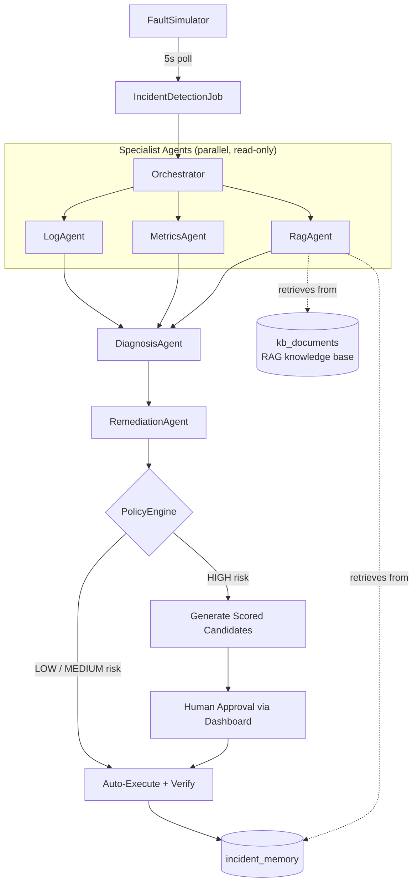

# Primus — Autonomous AIOps / Incident Response Platform

> An AI-powered platform that observes infrastructure, diagnoses incidents through evidence-based, hypothesis-driven reasoning, selects safe remediation actions, executes approved fixes, verifies recovery, and learns from history.

Primus was built to explore a core question in agentic AI system design: **does a coordinated team of specialist agents make safer, more accurate operational decisions than a single generalist agent with tool access?** The project implements both architectures side-by-side and evaluates them empirically.

---

## Table of Contents
- [Why Primus](#why-primus)
- [Architecture](#architecture)
- [Key Design Decision: Single-Agent vs Multi-Agent](#key-design-decision-single-agent-vs-multi-agent)
- [Eval Results](#eval-results)
- [Tech Stack](#tech-stack)
- [Running Locally](#running-locally)
- [Project Status](#project-status)

---

## Why Primus

Modern incident response tools surface alerts and dashboards, but the diagnostic and remediation reasoning is still manual. Primus automates that reasoning loop end-to-end:

1. **Detect** — continuously polls simulated infrastructure for faults
2. **Diagnose** — gathers evidence (logs, metrics, runbooks, past incidents) and forms a hypothesis
3. **Decide** — proposes a remediation action, gated by risk-based policy
4. **Act** — executes low/medium-risk fixes automatically; escalates high-risk fixes for human approval
5. **Verify** — confirms recovery
6. **Learn** — stores the resolved incident in memory for future retrieval

---

## Architecture



Each specialist agent returns a structured `AgentFinding` (agent name, confidence, summary, evidence, tools called), which the Orchestrator synthesizes into a final diagnosis and a single proposed remediation action.

### Module Breakdown

| Layer | Component | Responsibility |
|---|---|---|
| Detection | `FaultSimulator`, `IncidentDetectionJob` | Simulates infra faults; polls every 5s; auto-creates/resolves incidents |
| Diagnosis (LLM) | `GeminiClient` | Single-shot and multi-turn tool-calling via Gemini API |
| Retrieval | `EmbeddingClient`, `VectorMath`, `RetrievalService` | RAG over a knowledge-base table using cosine similarity (embeddings stored as JSON-string TEXT) |
| Tooling | `DiagnosticTools`, `ToolDefinitions` | Exposes `get_metrics`, `get_logs`, `search_runbooks`, `search_incident_memory`, `restart_service`, `rollback_deployment`, `scale_service`, each tagged with a risk level |
| Multi-Agent Core | `LogAgent`, `MetricsAgent`, `RagAgent`, `DiagnosisAgent`, `RemediationAgent`, `Orchestrator` | Fixed pipeline: parallel evidence-gathering specialists → synthesis → single remediation proposal |
| Safety | `PolicyEngine` | LOW/MEDIUM risk actions auto-execute; HIGH risk actions are blocked pending human approval |
| Memory | `IncidentMemoryService` | Stores resolved incidents; retrieved via cosine similarity for future diagnoses |
| Auth | `AuthController`, `JwtUtil`, `JwtAuthFilter` | JWT (HS512) + BCrypt + `@PreAuthorize` RBAC (VIEWER / ADMIN) |
| Frontend | React + TypeScript | Login, incident table, "Investigate" trigger, candidate review/approval UI |
| Evaluation | `EvaluationService`, `PrimusEvalAdapter` | Benchmarks 5 systems (rule-based, LLM-no-RAG, LLM-RAG, single-agent, multi-agent) across 10 simulated incidents |

A legacy single-agent implementation (`AgentLoop`) is preserved in the codebase — unwired from any live endpoint — purely as an evaluation baseline against the multi-agent architecture.

---

## Key Design Decision: Single-Agent vs Multi-Agent

Primus was first built as a single continuously-looping tool-calling agent (`AgentLoop`, max 6 rounds). It was then re-architected as a fixed-pipeline **multi-agent** system with specialist, single-purpose agents.

**Why the change:** evaluation revealed a subtle failure mode in the single-agent design — when its preferred high-risk fix (e.g. `rollback_deployment`) was correctly diagnosed but blocked by the policy engine, the agent's loop kept iterating and settled for an easier, auto-executable medium-risk action (e.g. `restart_service`) instead of surfacing the blocked high-risk fix for approval. The multi-agent `RemediationAgent`, by contrast, proposes exactly one action per run with no fallback loop, which avoids this collapse.

This was **discovered, not assumed** — via a dedicated evaluation harness comparing both systems on identical simulated incidents. See `EVAL_RESULTS.md` for current numbers and a full writeup of the eval pipeline audit that made those numbers trustworthy.

---

## Eval Results

Evaluation ran 5 systems against 10 identical simulated incidents each. The eval harness itself was audited and had 4 real measurement bugs found and fixed (cause-unaware fault simulation, a log-text keyword collision, missing ground-truth branches, and an approval-gate distortion) — full writeup in `EVAL_RESULTS.md`. After fixing all four, `remediationAccuracyPct` and `resolvedPct` now agree for every system, meaning the eval is internally consistent.

| System | Diagnosis Accuracy | Remediation Accuracy | Resolved |
|---|---|---|---|
| rule_based | 100% | 100% | 100% |
| llm_no_rag | 20% | 40% | 40% |
| llm_rag | 100% | 30% | 30% |
| single_agent_primus | 40% | 80% | 80% |
| multi_agent_primus | 90% | 60% | 60% |

**Key finding:** Multi-agent Primus has the strongest diagnosis accuracy (90%) but its remediation agent sometimes proposes `restart_service` instead of the objectively-correct `scale_service` on connection-pool-exhaustion cases — a genuine LLM judgment limitation on an ambiguous case (both are plausible real-world responses to "connection" symptoms), not a measurement error. Full analysis in `EVAL_RESULTS.md`.

---

## Tech Stack

**Backend:** Java 25, Spring Boot 4.1.1, PostgreSQL 17 + Flyway migrations, Google Gemini API (`gemini-3.1-flash-lite`)
**Frontend:** React + TypeScript, Vite
**Auth:** JWT (JJWT 0.12.6, HS512) + BCrypt + Spring Security RBAC
**Infra:** Docker Compose (postgres / backend / frontend), GitHub Actions CI (Postgres 17 service container)
**Testing:** JUnit + Mockito — 21 tests, passing in CI

---

## Running Locally

```bash
git clone https://github.com/thesupremesorcerror/Primus.git
cd Primus
docker compose up
```

Backend: `http://localhost:8080` · Frontend: `http://localhost:5173`

Set `GEMINI_API_KEY` in your environment before starting the backend.

---

## Project Status

Core pipeline (detection → diagnosis → RAG → tool-agent → multi-agent orchestration → policy gating → auth/RBAC → eval harness) is complete, tested, and passing in CI.

**In progress:**
- Live deployment (Render / Fly.io / Railway)
- Secrets hygiene (moving off plaintext env vars)
- Exponential backoff on repeated Gemini API failures (a fixed-interval throttle already exists; note that a *daily quota* exhaustion, as opposed to a rate limit, can't be fixed by backoff alone)
